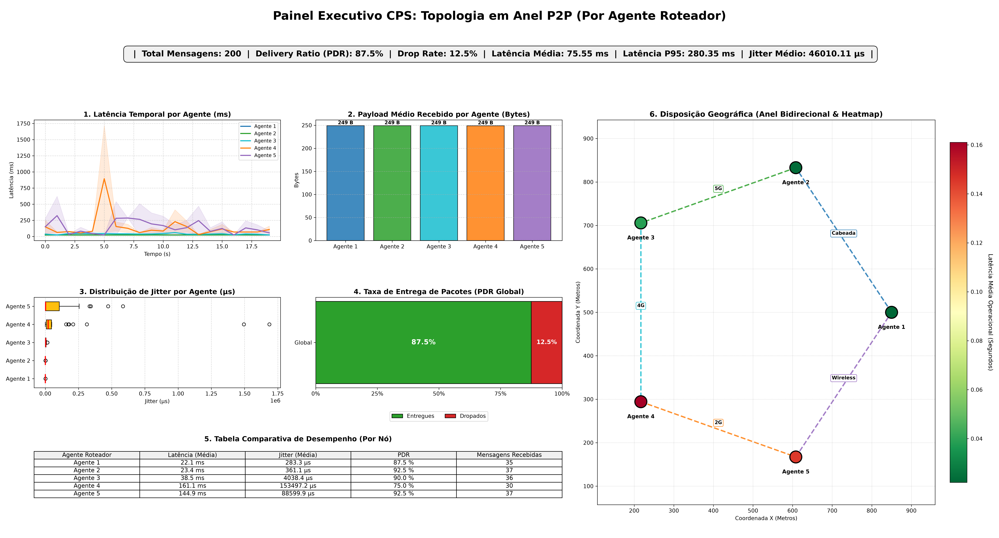

# Sumário Executivo

O time TSCC desenvolveu, entre fevereiro e outubro de 2026, uma plataforma de co-simulação que acopla agentes PADE, o simulador de rede OMNeT++ e o orquestrador Mosaik, executados em três containers Docker e sincronizados em *lock-step* via ZeroMQ. O objetivo é substituir a hipótese de comunicação ideal entre agentes por uma rede com latência, jitter, perda, filas finitas e posição geográfica.

O ponto de partida era um bloqueio de infraestrutura onde o container do OMNeT++ não iniciava. Hoje a plataforma suporta topologias (estrela, malha completa e anel bidirecional) escaláveis até centenas de agentes, tecnologias de enlace (Cabeada, 5G, Wireless, 4G e 2G) atribuíveis por enlace ou por agente, telemetria de alta resolução e dashboards automáticos, tudo configurável por uma interface web ou pelo terminal.

# Introdução

## Contextualização

Sistemas ciberfísicos no domínio energético dependem da troca coordenada de informações entre controladores, agentes, sensores e simuladores especializados. Nesses sistemas a comunicação influencia diretamente a validade dos resultados: atrasos, perdas, jitter e saturação de canais podem alterar a dinâmica observada em estratégias distribuídas, como leilões de energia e coordenação de recursos energéticos distribuídos.

No projeto OpenTES, o TSCC é responsável pela simulação de comunicação e co-simulação, uma das quatro frentes do projeto, ao lado de modelagem econômica, rede elétrica e qualidade de energia. O código-fonte está em `grei-ufc/tscc-com-opentes`.

## Motivação

Em simulações de sistemas multiagentes é comum assumir mensagens instantâneas e sem perdas. Isso impede avaliar a robustez de uma estratégia sob infraestrutura real. A motivação do time foi tornar a rede uma variável experimental: o pesquisador escolhe topologia, tecnologia de enlace e escala, e observa o efeito sobre o tráfego dos agentes. Há também uma motivação de engenharia: conectar ferramentas heterogêneas de forma reprodutível e operável por terceiros, o que levou à conteinerização e às interfaces de configuração.

## Justificativa

A camada de comunicação é o elo entre os demais times do OpenTES. Decisões tomadas nela (formato de mensagem, granularidade temporal, política de filas) condicionam como outros módulos serão acoplados. A revisão bibliográfica da equipe indicou ainda uma lacuna: o trabalho de referência na área, o COSIMA, não detalha a justificativa da estrutura de co-simulação, não compara desempenho entre topologias e não explica a conteinerização.

## Objetivos

### Objetivo geral

Construir e documentar uma plataforma de co-simulação PADE + OMNeT++ + Mosaik que represente, com fidelidade configurável, os efeitos de redes de comunicação heterogêneas sobre sistemas multiagentes em redes elétricas inteligentes.

### Objetivos específicos

1. Integrar PADE, Mosaik e OMNeT++ em containers separados, com sincronismo determinístico.
2. Modelar latência, jitter, perda de pacotes, congestionamento e efeito de distância, com perfis de tecnologia.
3. Suportar múltiplas topologias com escalabilidade dinâmica.
4. Prover telemetria e dashboards que permitam comparar tecnologias e topologias.
5. Facilitar o uso e a reprodução.
6. Revisar a literatura e produzir um artigo científico.

# Estado da Arte e Revisão Bibliográfica

A revisão concentrou-se na família de trabalhos do COSIMA, que acopla o Mosaik ao OMNeT++ para simular a infraestrutura de comunicação de sistemas de energia. O ponto de partida técnico da equipe foi reproduzir o exemplo do COSIMA em containers. A versão atual não depende do COSIMA: o acoplamento Mosaik–OMNeT++ foi reescrito sobre ZeroMQ, com criação dinâmica de nós a partir de um arquivo NED gerado em tempo de execução.

O artigo *cosima-mango: Investigating Multi-Agent System robustness through integrated communication simulation* foi revisado em detalhe, com foco na comparação entre os frameworks de SMA PADE e Mango. A Tabela 1 resume a comparação feita pela equipe.

| Critério | PADE | Mango |
|---|---|---|
| Foco | Redes elétricas inteligentes | Propósito geral |
| FIPA/AMS | Nativo | Implementação a cargo do usuário |
| Base assíncrona | Twisted | `asyncio` |
| Integração com Mosaik | Driver pronto (API 3.0+) | Orquestrador de tempo e *wrappers* a cargo do usuário |
| Logging | CSV nativo | A cargo do usuário |

Table: Comparação estrutural PADE × Mango (revisão do TSCC, jul./2026).

Em relação à literatura revisada, o diferencial do trabalho do TSCC é: (i) uso de uma versão atualizada do PADE; (ii) conteinerização documentada da co-simulação; (iii) comparação planejada entre topologias e tecnologias de enlace; e (iv) comunicação FIPA-ACL pura entre agentes, com a rede simulada invisível para a aplicação.

# Materiais e Métodos

O desenvolvimento foi incremental, com ciclos semanais de implementação, teste e relato em *short-reports*, em branches de trabalho (`main` e `development`).

## Ambiente e ferramentas

| Componente | Papel | Versão / observação |
|---|---|---|
| PADE | Agentes FIPA-ACL | `pade-agents`; Twisted 24.7.0 |
| Mosaik | Orquestração e tempo simulado | 3.6.0; `mosaik-api-v3` 3.0.14 |
| OMNeT++ | Simulação de rede | Imagem `omnetpp/omnetpp:u22.04-6.0` |
| ZeroMQ | Transporte Mosaik–OMNeT++ | `pyzmq` 27.1.0; `cppzmq` |
| `nlohmann/json` | Serialização no lado C++ | Pacote do Ubuntu 22.04 |
| Docker Compose | Orquestração de 3 containers (`pade`, `omnet_sim`, `mosaik_master`) | Namespace de rede compartilhado (`service:pade`) |
| Streamlit, Plotly, Matplotlib | Interface web, CLI, dashboards e suíte `pytest` | Pré-instalados nos Dockerfiles e validados em Python 3.12 |

Table: Ferramentas e versões utilizadas no repositório.

## Arquitetura

A Figura 1 apresenta a arquitetura. Os agentes PADE enviam mensagens com `send()`. Um interceptador sobrescreve esse método: mensagens da ontologia de simulação (`telemetria_rede` em estrela e malha, `malha_restrita` no anel) são serializadas em JSON (performativa, remetente, destinatários, conteúdo, ontologia, `conversation_id`) e acumuladas no atributo `val_out`, separadas por `|||`. Mensagens de controle do PADE seguem pelo caminho nativo. O Mosaik transfere `val_out` ao nó correspondente do OMNeT++ (`val_in`) e devolve as mensagens entregues ao agente no passo seguinte, com `time_shifted=True`, que quebra o ciclo de causalidade.

\begin{figure}[H]
\centering
\small
\begin{verbatim}
+----------+  val_out  +-----------+   STEP   +-----------+
| pade     |---------->| mosaik    |--------->| omnet_sim |
| agentes  |           | scenario  |   ZMQ    | Mosaik-   |
| FIPA-ACL |<----------| collector |  REQ/REP | Bridge +  |
| Twisted  |  val_in   | plots     |<---------| AgentNode |
+----------+           +-----+-----+          +-----------+
                             |
                   results.csv + dashboards
\end{verbatim}
\caption{Arquitetura da co-simulação: três containers integrados via namespace de rede compartilhado (\texttt{service:pade}), configurados por variáveis de ambiente (\texttt{TOPOLOGY}, \texttt{NUM\_PERIFERICOS}, \texttt{TIPOS\_REDE}, \texttt{RANDOM\_SEED}) definidas pela interface web ou pelo CLI.}
\end{figure}

O `MosaikBridge.cc` mantém um socket ZeroMQ `REP` bloqueante. A cada passo, o `omnet_wrapper.py` envia as entradas, o OMNeT++ avança um tick (`scheduleAt(simTime()+timeResolution)`) e responde com as saídas, o passo atual e a telemetria. Como cada lado espera a resposta do outro, o sincronismo é garantido por construção. Os containers `omnet_sim` e `mosaik_master` compartilham o namespace de rede do container `pade` (`network_mode: "service:pade"`), comunicando-se via loopback (`127.0.0.1`), o que assegura compatibilidade tanto em ambientes Docker locais quanto em ambientes em nuvem como o GitHub Codespaces. O `scenario.py` lê `TOPOLOGY`, `NUM_PERIFERICOS`, `TIPOS_REDE` e `RANDOM_SEED`, sorteia as posições em uma área de 1000 × 1000 m (ou em círculo de raio 350 m no anel), persiste `posicoes.json`, `links.json` e `config.json`, gera o `DynamicNetwork.ned` e cria as entidades no Mosaik.

## Topologias e perfis de enlace

| Topologia | Agentes | Enlaces | Comportamento dos agentes |
|---|---|---|---|
| Estrela | 1 central + N periféricos | N | Central faz *broadcast*; periféricos respondem ao central |
| Malha completa | N *peers* (`NUM_PERIFERICOS`) | $N(N-1)/2$ | Todos enviam a todos a cada passo |
| Anel | N *peers* (`NUM_PERIFERICOS`) | N (ciclo fechado) | Cada agente envia aos dois vizinhos |

Table: Topologias suportadas pela plataforma.

| Perfil | Banda | Atraso | PER (canal) |
|---|---|---|---|
| Cabeada | 1 Gbps | 1 ms fixo | 0 |
| 5G | 500 Mbps | truncnormal(5 ms; 1 ms) | 0,001% |
| Wireless | 300 Mbps | truncnormal(2 ms; 0,5 ms) | 0,1% |
| 4G | 50 Mbps | truncnormal(35 ms; 8 ms) | 0,5% |
| 2G | 250 kbps | exponential(200 ms) | 15% |

Table: Perfis de enlace definidos em `Profiles.ned`. Os tipos são atribuídos ciclicamente aos enlaces ou, na interface, por agente.

## Modelo de rede implementado no nó

O módulo `AgentNode.cc` implementa: (i) fila de transmissão por porta, limitada a 5 pacotes, com descarte do excedente; (ii) descarte no receptor tanto por erro de bit nativo do canal, regido pelo PER, quanto por atenuação espacial dependente de distância e tamanho; (iii) atraso adicional por distância e ruído de jitter sobre o atraso-base em canais `cDatarateChannel` e `cDelayChannel`; e (iv) telemetria por pacote, exportada em strings multiplexadas com `|||`. Em notação simplificada, com $d$ em metros e $S$ em bytes:

$$
P_{\text{drop,dist}} = \min\!\left(0{,}99;\ \frac{d}{100}\,0{,}015\,\max\!\left(1;\frac{S}{15000}\right)\right),
\qquad
L = d_{\text{canal}} + \frac{8S}{R} + 5\times10^{-5}\,d + \eta
$$

em que $R$ é a taxa do canal, $d_{\text{canal}}$ o atraso do perfil NED e $\eta$ um ruído de até 25% do atraso-base (aplicado quando este excede 1,5 ms). As métricas reportadas são latência fim a fim, jitter (diferença absoluta entre latências consecutivas por origem), razão de entrega $\text{PDR}=\text{recebidos}/\text{enviados}$ e tamanho de payload.

# Resultados e Discussão

## Evolução do desenvolvimento

| Período | Marco principal |
|---|---|
| Fev.–mar. | Containers separados Mosaik e OMNeT++; correção de conflito de portas; co-simulação via ZeroMQ (`results.csv` com `data_out` 0 a 9); medição de latência e teste de escalabilidade |
| Abr. | Contador de passos e `time_resolution`; ciclo de realimentação `time_shifted`; modo híbrido (eventos não persistentes) no PADE; Mosaik 3.6.0; ciclo "ping-pong" bidirecional com latência $10\,\text{ms}+\text{bits}/\text{banda}$ |
| Mai. | Banda configurável, perda e jitter estocásticos; topologia estrela (`pade_star.py`); telemetria multiplexada; protótipo de CLI; estudo de parâmetros 5G e Wi-Fi |
| Mai.–jun. | Migração para FIPA nativo (`send()`/`react()`), com filas anti-sobrescrita; NED elástico; canais `DatarateChannel` heterogêneos; início do artigo |
| Jul. | Revisão bibliográfica; nós independentes com filas e rajadas (*bursts*); roteamento pelo campo `receivers`; 50+ agentes via variável de ambiente; perfis 4G/5G/2G |
| Ago. | Posicionamento geográfico e atraso/descarte por distância; dashboards refatorados; topologias malha e anel; menu e interface Streamlit |
| Set.–out. | Anel escalável; ícones SVG, tecnologia por agente, aba de resultados; consolidação do orquestrador `scenario.py`, rede compartilhada no Docker e suíte de validação automatizada (`pytest`) |

Table: Cronologia sintética (detalhes nos *short-reports* semanais).

Dois problemas relevantes foram resolvidos ao longo da construção da plataforma: a **perda de mensagens por concorrência temporal** (resolvida com a fila delimitada por `|||` nos dois lados) e o **gargalo do canal ocupado** em rajadas (resolvido com filas reais `cPacketQueue` no C++ e descoberta automática da identidade do nó via `getName()`).

## Resultados experimentais nas três topologias

Para caracterizar o funcionamento da ferramenta nas três topologias suportadas, foram executadas co-simulações de 20 passos (`SIM_STEPS=20`, `RANDOM_SEED=42`) combinando as cinco tecnologias de enlace (`Link_Wired`, `Link_5G`, `Link_4G`, `Link_2G` e `Link_Wireless`) distribuídas ciclicamente entre os enlaces. As Figuras 2, 3 e 4 apresentam os dashboards gerados automaticamente pelos módulos `plot_results_star.py`, `plot_results_malha.py` e `plot_results_anel.py`.

{ width=96% }

{ width=92% }

{ width=92% }

A Tabela 5 detalha as métricas obtidas por tecnologia de enlace na topologia Estrela ($N=20$), e a Tabela 6 sintetiza os resultados globais das três topologias.

| Rede | Latência média | Jitter médio | PDR (Taxa de entrega) | Amostras (pacotes entregues) |
|---|---:|---:|---:|---:|
| Cabeada | 20,1 ms | 0,0 µs | 100,0% | 156 |
| Wireless | 23,9 ms | 659,9 µs | 96,5% | 136 |
| 5G | 26,8 ms | 1.209,2 µs | 98,0% | 148 |
| 4G | 48,2 ms | 8.952,7 µs | 94,6% | 139 |
| 2G | 223,5 ms | 161.078,2 µs | 84,7% | 105 |
| **Global (Estrela)** | **59,24 ms** (P95: 242,04 ms) | **26.939,10 µs** | **91,6%** | **684** (de 747 enviados) |

Table: Desempenho por tecnologia de enlace na topologia Estrela ($N=20$, 20 passos, `RANDOM_SEED=42`).

| Topologia | Agentes / Enlaces | Enviados | Recebidos | Descartados | PDR Global | Latência média (P95) | Jitter médio | Payload médio |
|---|---:|---:|---:|---:|---:|---:|---:|---:|
| **Estrela** ($N=20$) | 21 / 20 | 747 | 684 | 63 | 91,6% | 59,24 ms (242,04 ms) | 26.939,1 µs | 481,6 B |
| **Malha** ($N=5$) | 5 / 10 | 400 | 364 | 36 | 91,0% | 66,79 ms (279,81 ms) | 27.923,4 µs | 299,8 B |
| **Anel** ($N=5$) | 5 / 5 | 200 | 175 | 25 | 87,5% | 75,55 ms (280,35 ms) | 46.010,1 µs | 249,0 B |

Table: Resultados consolidados nas três topologias suportadas (20 passos, `RANDOM_SEED=42`).

## Discussão

**Diferenciação física entre os perfis de enlace.** Os resultados da Tabela 5 confirmam a aderência do modelo implementado em `AgentNode.cc` e `Profiles.ned` às características físicas de cada tecnologia. A rede **Cabeada** apresenta latência média de 20,1 ms (1,0 ms base somado ao atraso de propagação espacial de $50\,\mu\text{s/m}$ no grid de $1000\times 1000\text{ m}$), jitter nulo (0,0 µs, dado que o atraso-base não excede 1,5 ms) e entrega integral (100,0% de PDR). Os enlaces **Wireless** e **5G** operam com baixa latência (23,9 ms e 26,8 ms), jitter reduzido (0,66 ms a 1,21 ms) e PDR elevado (96,5% a 98,0%). Já o perfil **4G** apresenta latência intermediária de 48,2 ms e jitter de 8,95 ms (PDR de 94,6%), enquanto o canal **2G** (250 kbps, atraso exponencial de 200 ms e PER de 15%) concentra a maior degradação da rede, com latência média de 223,5 ms, jitter de 161,1 ms e queda da taxa de entrega para 84,7%.

**Comportamento por topologia e conservação de pacotes.** Nas três topologias observa-se conservação exata entre pacotes enviados, recebidos e descartados ($684+63=747$ na estrela; $364+36=400$ na malha; $175+25=200$ no anel). Na topologia **Estrela**, o tráfego converge no agente central, que dispara 20 requisições por passo e recebe as confirmações `INFORM` dos periféricos cujas mensagens superam as perdas de enlace. Na **Malha Completa** ($N=5$), todos os agentes atuam como *peers* simétricos trocando mensagens ponto a ponto sobre os 10 enlaces físicos ($5\times 4\times 20 = 400$ envios). No **Anel Bidirecional** ($N=5$), a comunicação restrita aos dois vizinhos imediatos em ciclo fechado gera 200 transmissões distribuídas igualmente sobre os 5 enlaces.

**Granularidade temporal.** Cada passo do Mosaik corresponde a 1 s simulado, enquanto as latências típicas situam-se na escala de dezenas a centenas de milissegundos. Como os agentes recebem as mensagens no passo seguinte (`time_shifted=True`), as variações de latência e jitter são integralmente registradas na telemetria física do OMNeT++, enquanto o efeito direto sobre a dinâmica de decisão dos agentes PADE ocorre sobretudo por meio do descarte de pacotes.

# Conclusão

Os objetivos estabelecidos para o TSCC foram integralmente alcançados. A plataforma integra PADE, Mosaik e OMNeT++ em containers Docker sincronizados via ZeroMQ (Objetivo 1), modela latência, jitter, perda de pacotes por canal e por distância e filas finitas em cinco tecnologias de enlace (Objetivo 2), suporta geração dinâmica e escalável das topologias estrela, malha completa e anel bidirecional (Objetivo 3), fornece telemetria detalhada em CSV e dashboards automáticos por tecnologia e topologia (Objetivo 4), e dispõe de interfaces de configuração via navegador (`menu-streamlit.py`) e terminal (`menu.py`), além de suíte de testes automatizados com `pytest` (Objetivo 5).

Como próximos passos do projeto, destacam-se:

1. **Execução de campanhas experimentais multi-semente** (variando `RANDOM_SEED`) para consolidação estatística dos resultados no artigo científico em elaboração (Objetivo 6).
2. **Refinamento da resolução temporal (`time_resolution` sub-segundo) e implementação de fragmentação por MTU**, ampliando a sensibilidade da co-simulação a atrasos sub-segundo e payloads extensos.
3. **Acoplamento da plataforma de comunicação aos módulos dos demais times do OpenTES** (TSRE, TSDQ e TTESO), permitindo avaliar algoritmos de mercado transativo e controle de redes elétricas sob condições realistas de comunicação.

# Referências

[1] OPENTES. *Repositório geral do projeto* (inclui os *short-reports* semanais do TSCC, 20/02 a 02/10/2026). Disponível em: <https://github.com/grei-ufc/general-opentes>. Acesso em: 22 out. 2026.

[2] GREI-UFC. *tscc-com-opentes: co-simulação PADE + OMNeT++ + Mosaik* (branch `development`). Disponível em: <https://github.com/grei-ufc/tscc-com-opentes>. Acesso em: 22 out. 2026.

[3] MOSAIK. *Mosaik: smart grid co-simulation framework*. Disponível em: <https://mosaik.offis.de>.

[4] OMNeT++. *OMNeT++ Discrete Event Simulator* e *INET Framework*. Disponíveis em: <https://omnetpp.org> e <https://inet.omnetpp.org>.

[5] GREI-UFC. *PADE: Python Agent DEvelopment framework*. Disponível em: <https://github.com/grei-ufc/pade>.

[6] MANGO. *mango: Modular Python Agent Framework*. Disponível em: <https://github.com/OFFIS-DAI/mango>.

[7] FIPA. *FIPA ACL Message Structure Specification*. Foundation for Intelligent Physical Agents. Disponível em: <http://www.fipa.org>.

[8] ZEROMQ. *ZeroMQ: distributed messaging*. Disponível em: <https://zeromq.org>.
